# Phishing Detector on AWS: Cloud Monitoring Engineer Home Assignment

- **Part 1:** a phishing email detector with a web UI.
- **Part 2:** the detector running on two EC2 instances behind an ALB, with RDS, built with Terraform and monitored with CloudWatch.
- **Bonuses:** a Gmail add-on, performance (auto scaling) and ElastiCache.

```
app/            detector, web app (FastAPI), tests, sample emails
gmail-addon/    Gmail add-on (Apps Script)
terraform/      foundation/ (VPC, security groups, RDS) · app/ (ALB, ASG, ElastiCache, monitoring)
docs/           architecture diagram, screenshots
```

---

## Architecture

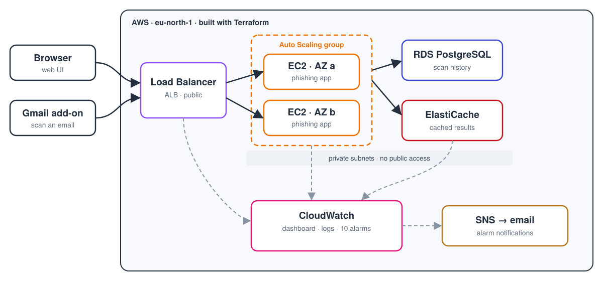

<sub>Detailed version with subnets, security groups and AZs: [docs/architecture-detailed.png](docs/architecture-detailed.png)</sub>

- **The ALB is the only public entry point.** The instances, RDS and ElastiCache run in private subnets across two availability zones.
- **Security groups only allow the chain** `internet → ALB → app → RDS / cache`.

---

## Part 1: Phishing detector

The detector accepts a `.eml` file or pasted text. It returns a **verdict** (Safe, Suspicious or Phishing), a **risk score** from 0 to 100, and the **indicators** it found, each with an explanation.

| Indicator | Examples |
|---|---|
| **Suspicious links** | Link text shows one domain but points to another, raw IP, look-alike domain, URL shortener, risky TLD, `http` |
| **Spoofed sender** | Look-alike domain (`paypa1.com`), brand in the display name from another domain, Reply-To or Return-Path mismatch, punycode |
| **Suspicious wording** | Credential requests, threats, urgency, money, generic greeting (English and Hebrew) |
| **Attachments** | Executables, double extensions (`invoice.pdf.exe`), macro-enabled Office files, archives |
| **History** | The sender's domain was flagged in earlier scans |

**Risk scoring:**
- Points add up. Each group is capped at 50 and the total at 100.
- **Safe** is below 25, **Suspicious** is 25–59 and **Phishing** is 60 or more.

**History:** every scan is saved in the database (RDS) and shown in the UI. Earlier scans also feed back into detection, through the "History" indicator above.

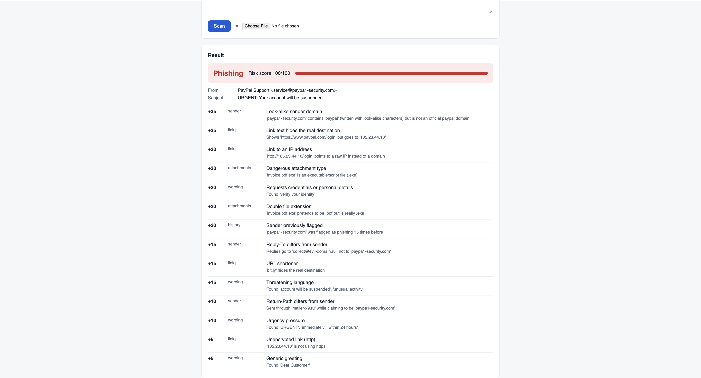
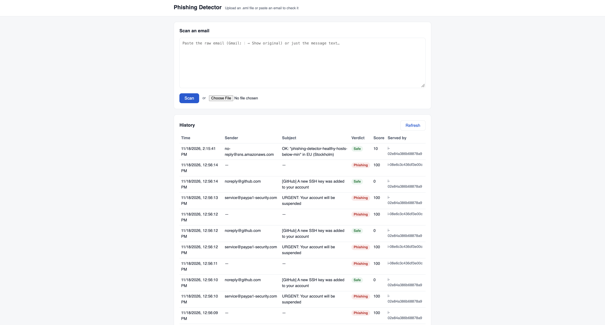

---

## Part 2: Infrastructure (Terraform)

| Component | Configuration |
|---|---|
| ALB | Public, port 80, health check on `/health` |
| EC2 | Auto Scaling group with 2 × `t3.micro` (one per AZ) in private subnets, ELB health checks, rolling deploys |
| RDS | PostgreSQL 16 `db.t4g.micro`, private, encrypted; password generated and stored by Secrets Manager |
| Network | VPC, public and private subnets in 2 AZs, NAT Gateway |

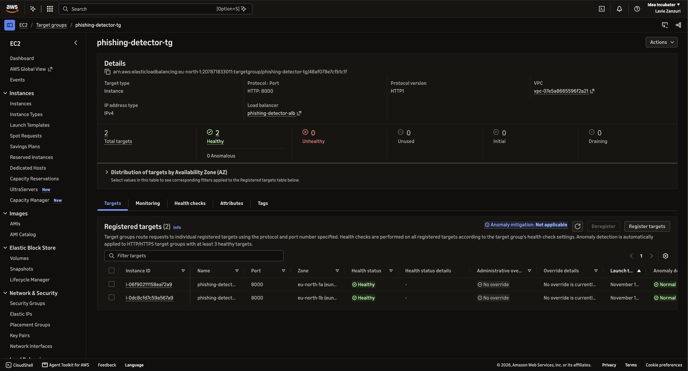
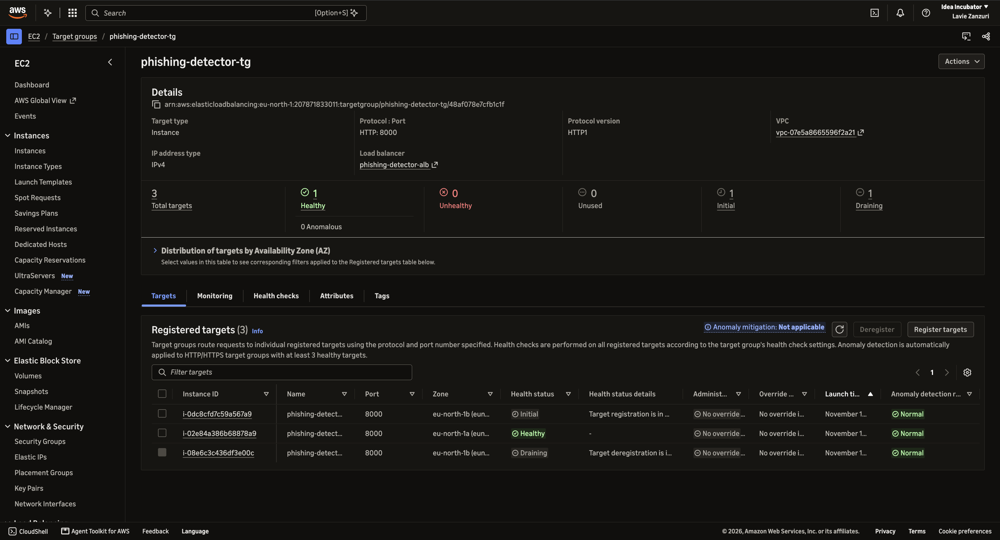

---

## Monitoring

A CloudWatch dashboard (`phishing-detector`) answers each of the required questions:

| Question | Answer |
|---|---|
| **Are the EC2 instances healthy?** | ALB `HealthyHostCount` / `UnHealthyHostCount` and ASG in-service instances |
| **CPU and system usage?** | CPU per instance; memory and disk from the CloudWatch agent |
| **Load balancer request count?** | ALB `RequestCount` |
| **Success vs failure?** | Responses by status code (2xx / 4xx / 5xx), success rate %, p95 latency |
| **Where are the app logs?** | CloudWatch Logs **`/phishing-detector/app`** (JSON, one stream per instance); on the instance: `/var/log/phishing/app.log` |

**Alarms:** 10 alarms send email through SNS. They cover unhealthy hosts, 5xx errors, p95 latency, CPU, memory, app errors, and RDS CPU and storage.

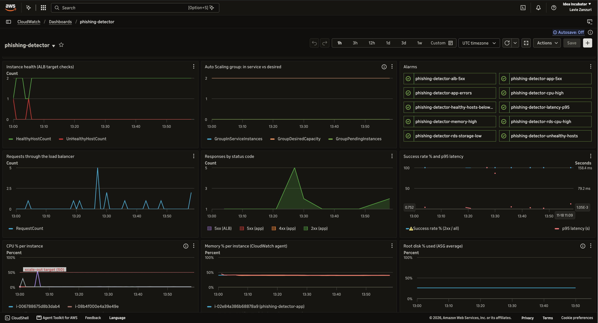
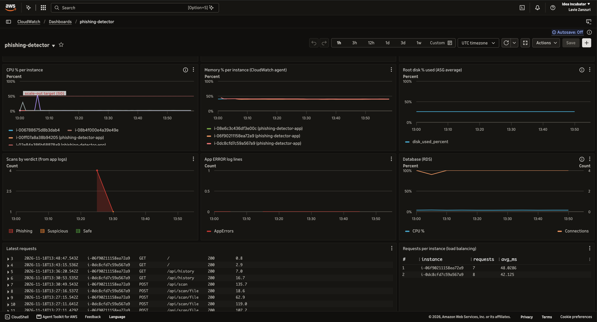
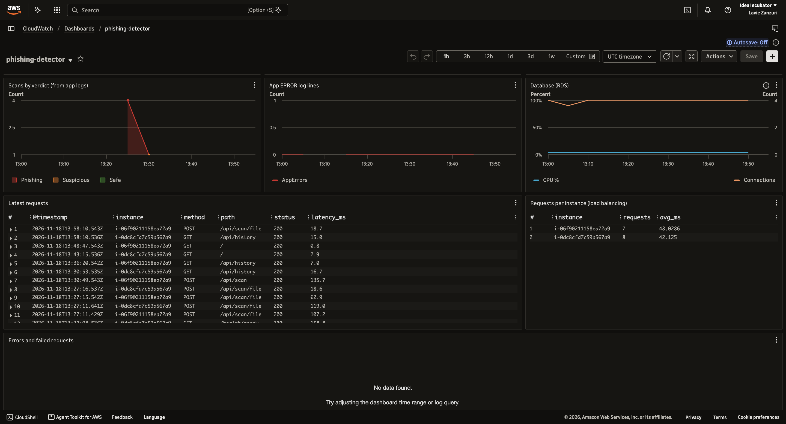
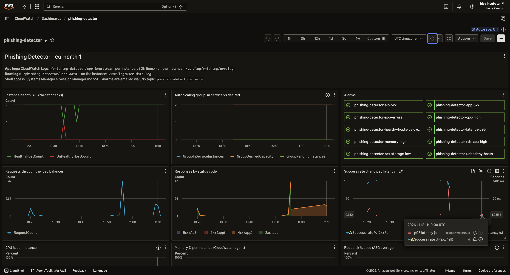
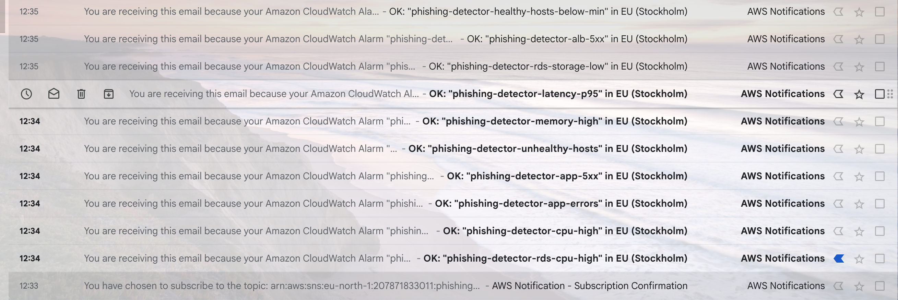

---

## Bonuses

**Gmail add-on** (`gmail-addon/`)
- Adds a **Scan this email** button inside Gmail and shows the verdict next to the email.
- To install it as a test deployment:
  1. In Apps Script, paste the two files.
  2. Set the Script Property `API_URL` to the ALB address.
  3. Choose **Deploy → Test deployments → Install**.

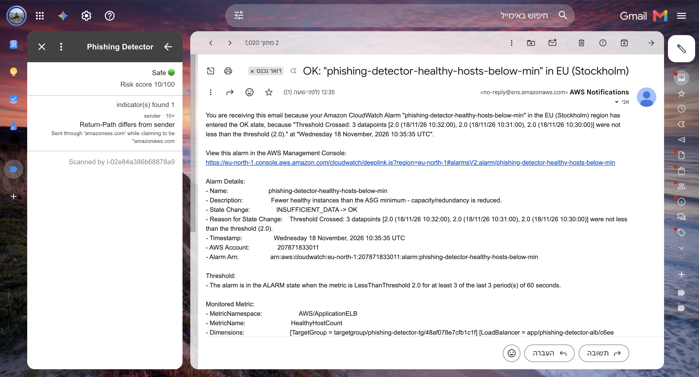

**Performance**
- The Auto Scaling group scales between 2 and 4 instances, targeting 50% CPU.
- Instances report metrics every minute (detailed monitoring).
- An alarm fires on p95 latency.

**ElastiCache (Valkey)**
- Scan results are cached by the email's hash, so the same email is analysed only once.
- The cache is shared by both instances.
- If the cache is down, the app keeps working without it.

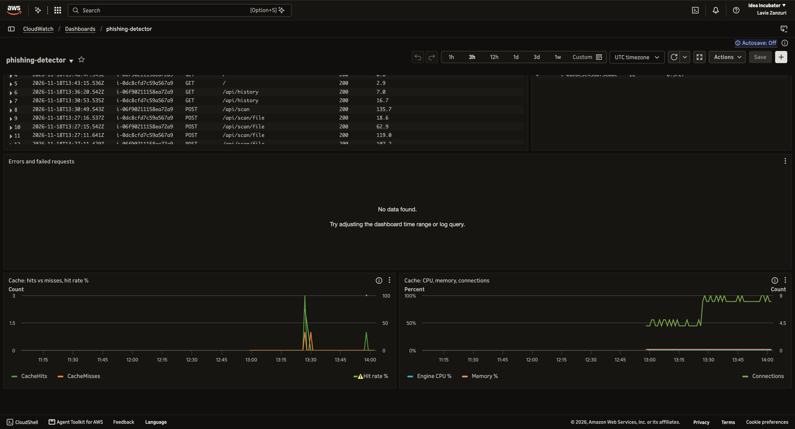

---

## How to run

**Locally:**
```bash
cd app
python3.11 -m venv ../.venv && source ../.venv/bin/activate
pip install -r requirements-dev.txt
python -m pytest -q                          # 156 tests
python cli.py samples/phishing_paypal.eml    # CLI
uvicorn web.main:app --reload                # UI on http://localhost:8000
```

**On AWS** (region eu-north-1). Terraform state is kept in an S3 bucket, which is created once beforehand.
```bash
cd terraform/foundation && terraform init && terraform apply
cd ../app && cp example.tfvars terraform.tfvars   # set alert_email
terraform init && terraform apply                  # outputs: app_url, dashboard_url
```

**Tear down:**
```bash
cd terraform/app && terraform destroy
cd ../foundation && terraform destroy
```

No credentials or secrets are stored in this repository:
- The database password lives in Secrets Manager.
- The instances use an IAM role.
- `terraform.tfvars` is git-ignored.
